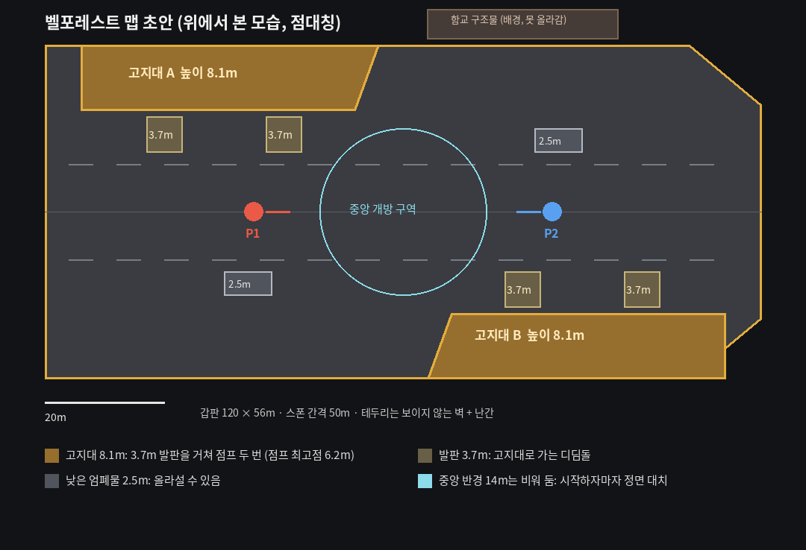

# 중장기갑 파트라슈 기획서 V3

Nov 15, 2026 · @문채욱

## V3 개요

V3는 조작을 아케이드식으로 단순하게 바꾸고, 시점을 1인칭에서 버추얼온식 백뷰로 바꾼다. 조종하는 느낌은 어려운 입력이 아니라 기체의 반응(무게, 진동, 소리, 화면)으로 만든다.

바꾸는 이유는 SW 체험주간을 준비하며 직접 플레이해 보고 확인한 문제들이다.

- **1인칭이라 내 기체가 안 보인다.** 펀치, 가드, 걸음 모션을 플레이어가 볼 수 없고, 상대가 옆이나 뒤로 가면 놓친다.
- **R스틱 하나가 시점과 전력질주를 같이 맡는다.** 달리려다 화면이 돌아가는 문제가 계속 생겼다.
- **트윈스틱 전력질주 입력이 어렵다.** R스틱을 0.15초 안에 L스틱과 ±20° 안으로 꺾는 조작은 처음 잡은 사람이 못 한다.
- **다리 길이에 비해 이동이 빠르다.** 걷기 10m/s는 걸음으로 표현하면 초당 10걸음이라 무게감이 안 난다. 가속도 시스템도 무게감을 만들지 못했다.

트윈스틱은 원래 "메카를 두 손으로 직접 조종하는 느낌"을 위한 것이었다. V3는 그 느낌을 입력이 아니라 반응으로 옮긴다.

## 게임 개요

공중 항모 갑판에서 버나드 표준형(PSX-0001) 두 기가 붙는 1대 1 아케이드 메카 격투다. Unity 6(URP), 리지드바디 물리 기반이다.

| 항목 | 내용 |
| --- | --- |
| 형식 | 1대 1, 3판 2선승, 한 PC에서 패드 2개로 화면 분할 |
| 기체 | 버나드 표준형 미러전. 원거리 무기 없음 (주먹, 몸통, 스러스터, 작업 도구만) |
| 모드 | 타이틀에서 VERSUS(2인 대전) 또는 PRACTICE(연습 봇) |
| 맵 | 벨포레스트: 구름 위 공중 항모 갑판. 120 × 56m, 8.1m 고지대 2곳 (아래 맵 참고) |
| 그래픽 | 셀 셰이딩 + 화면 외곽선, 하늘과 구름 배경, 낮은 각도의 태양 |

### 설계 원칙 (V3)

- **조작은 쉽게, 판단은 깊게:** 버튼은 적게 쓰고, 같은 버튼이 거리와 상태에 따라 다른 기술이 된다.
- **상대를 보고 있는 것이 자원이다:** 카메라는 내 몸 뒤에 고정된다. 상대 시야 밖으로 돌아 들어가는 것 자체가 공격이다.
- **이동이 재미다:** 아슬아슬하게 걸어서 피하다가, 대시가 펑 터지고 점프로 훅 솟구친다.
- **무게는 반응으로:** 히트스톱, 진동, 소리, 착지 흔들림, 전신 모션이 무게를 만든다. 가속도 같은 조작 지연으로 만들지 않는다.
- **만능 방어는 없다:** 가드, 패리, 옆 대시, 점프가 각자 다른 공격에 강하다.
- **현실적인 기계 논리:** 무장은 원래 작업 도구다. V2의 "지면 밀착, 점프 없음" 원칙은 폐기하고, 스러스터로 뛰는 높고 느린 점프를 넣는다.

## 카메라와 시점

카메라는 내 기체 뒤쪽 위에 고정된 백뷰다. 플레이어가 시점만 따로 돌리는 조작은 없다. 시점을 바꾸는 방법은 몸을 돌리는 것뿐이다.

| 항목 | 규칙 |
| --- | --- |
| 위치 | 화면 구도로 맞춤: 서 있는 기체가 화면 높이의 약 45%, 머리는 화면 세로 중간쯤, 발은 아래 가장자리 바로 위, 지평선은 위에서 약 32%(약 10° 내려다봄). 몸의 회전을 부드럽게 따라감 |
| R스틱 | 제자리에서 몸 전체를 좌우로 회전. 하드락 안에서는 꺼짐 |
| 상대 쪽으로 시점 돌리기 | 점프(거리 무관), 대시 공격(유도 사거리 안), 하드락 진입(10m) |
| 화면 밖 상대 | 화면 가장자리에 상대 방향 화살표를 표시 |
| 지형 충돌 | 카메라가 지형이나 벽을 뚫으면 앞으로 당김 |
| 흔들림 | 착지, 히트스톱, 피격 흔들림은 지금처럼 유지 |

상대가 정면 ±34° 안에 있으면 R스틱 선회는 초당 132°로 느리고, 밖으로 벗어나면 초당 759°로 빨라진다(버추얼온 기준). 점프 중에는 초당 21°다. 그래서 상대가 옆으로 빠져도 금방 다시 잡을 수 있지만, 공중에서 놓치면 착지할 때까지 못 잡는다.

상체와 하체 분리는 겉모습으로만 남는다. 상체는 정면(하드락이면 상대)을 보고, 하체는 이동 방향으로 걸음을 표현한다.

## 이동

걷기, 대시, 점프의 속도와 시간은 버추얼온 오라탕 템진의 값을 버나드 키에 맞춰 그대로 쓴다. 가속도 시스템은 없고, L스틱을 밀면 즉시 그 방향의 속도로 걷는다. 치고 들어갈 때는 대시, 뛰어넘거나 상대를 다시 잡을 때는 점프를 쓴다.

| 동작 | 입력 | 속도·내용 | 자원 소모 |
| --- | --- | --- | --- |
| 걷기 | L스틱 0.3 이상 | 방향별 최대 속도로 즉시 이동(가속 없음). 하드락 밖은 몸 기준, 안은 상대 기준 | 없음 |
| 대시 | ○ + L스틱 방향 | 누른 순간 8방향으로 고정해 일직선. 첫 프레임부터 최고 속도. 아래 "대시 상세" | 없음 |
| 대시 정지 | 대시 중 ○ 다시 | 0.27초 동안 선형 감속하며 미끄러져 멈춤 | - |
| 사이드스텝 | L스틱 ←/→ 튕기기 | V8에서 제거. 근접 거리에선 근접 스텝, 멀리선 옆 대시가 대신한다 | 조금 |
| 점프 | △ | 이륙 준비 0.033초 후 23.0m/s로 솟구침. 중력 31.5m/s², 0.73초에 최고점 약 8.4m. 하강은 속도 상한(7.5m/s)이 있어 둥실 내려옴. 2단 점프 없음. 하강 중 △는 호버, 공중 ✕는 급강하. 뛰는 순간 점프 락온 | 없음 |
| 공중 대시 | 상승 중 ○ | 상승 중에만 가능. 땅 대시와 같은 시간표, 상승 중이면 중력 ×0.5 | 없음 |

### 방향별 속도 (버추얼온 템진 기준, 버나드 키 2.6m로 환산)

원본 내부 단위 1 = 0.118m, 60fps로 환산했다. 실제 버나드 키는 1.93m라 게임에서는 이 표 값의 0.74배로 돈다(걷기 앞 16.3, 대시 앞 17.9m/s, 점프 최고점 약 6.2m). 비율은 그대로라 버추얼온과 같은 느낌이다. 방향 사이는 선형 보간한다.

| 동작 (m/s) | 앞 | 45° | 옆 | 135° | 뒤 |
| --- | --- | --- | --- | --- | --- |
| 걷기 | 22.0 | 19.5 | 19.2 | 17.7 | 19.9 |
| 대시 | 24.1 | 22.7 | 22.3 | 21.3 | 14.2 |
| 점프 중 수평 이동 | 11.4 | 13.8 | 14.2 | 13.8 | 11.4 |
| 공중 대시 | 24.8 | 22.7 | 22.7 | 22.7 | 14.2 |

대시는 걷기보다 10% 정도만 빠르고, 뒤 대시는 걷기보다 느리다. 대시의 맛은 속도 차이가 아니라 출발 폭발, 방향 고정, 활주 자세에서 나온다. 뒤로 빼는 건 느리고 돌아 들어가는 건 빠르다.

### 대시 상세

버추얼온 오라탕 영상을 0.1초 단위로 나눠 본 대시를 기준으로 한다. 대시의 핵심은 상대를 정면에 둔 채 옆으로 휘 빠지는 것이다.

| 단계 | 시간 | 동작 |
| --- | --- | --- |
| 발동 | 누른 프레임 | 입력 지연 없이 방향별 최고 속도로 출발. 기체를 덮는 출발 폭발 연출(1\~2프레임) |
| 시작 | 0\~0.27초 | 속도 일정. 공격·점프는 못 함. ○ 재입력은 정지로 |
| 지속 | 최대 약 1.4초 | 속도 일정. 대시 공격·점프·○ 재입력(정지) 가능. 몸을 낮게 숙이고 발이 땅을 긁으며 미끄러짐 |
| 끝 | 0.27초 | 속도를 0까지 선형 감속하며 미끄러짐 |
| 끝난 뒤 | 0초 | 경직 없음. 대시 공격을 썼으면 경직 앞 0.2 / 옆 0.23 / 뒤 0.3 / 앞대각 0.22 / 뒤대각 0.27초 |

한 번의 대시는 최대 약 1.9초다. 부스트는 쓰지 않는다. 대시 한 번의 길이만 제한되고, 대시와 점프는 몇 번이든 이어 쓸 수 있다.

- **방향은 누른 순간 고정된다.** 대시 중에는 L스틱을 한 번 중립에 놓았다가 새 방향을 넣어야만 다시 꺾인다. 하드락 안에서 앞 대시는 그 순간 상대가 있던 쪽으로 직선으로 간다. 상대를 따라가는 건 대시 공격의 유도뿐이다.
- **카메라와 정면은 그대로다.** 옆이나 뒤로 대시해도 시점은 돌지 않고, 기체 모델만 대시 방향으로 몸을 틨다.
- **뒤 대시가 하드락에서 빠져나가는 수단이다.** 다만 14.2m/s로 느려서 쉽게 도망칠 수는 없다. 따로 만든 백대시는 폐기한다.
- **대시 공격과 태클:** 0.8초 미만이면 유도 대시 공격, 0.8초 이상 계속 달렸으면 차징 태클이다.
- **출처:** 동작 수치는 버추얼온 드림캐스트판을 분석해 얻은 값이다. 코드는 옮기지 않고 수치와 동작만 가져와 우리 구조에 맞게 새로 구현한다.

* 상대가 가까우면 느려진다(원본 규칙). 17.5m 안에서는 모든 이동이 ×0.78이고, 걷기는 6.1m 안에서 ×0.7까지 더 느려진다. 근접 스텝은 아래 표다.
* 걷기는 디지털에 가깝다. L스틱 0.3 이상이면 그 방향의 최대 속도, 그 아래는 정지다.
* 하드락에서 빠지려면 뒤 대시(14.2m/s)나 점프를 써야 한다. 뒤 대시는 느려서 쉽게 도망칠 수는 없다.
* 다리 모션은 실제 속도로 고른다. 대시는 호버 활주, 걷기는 스러스터 디딘걸음이다.

### 근접 스텝, 대시 재입력, 하강 (V10)

근접 구역(6.1m) 안에서 서 있다가 ○를 누르면 대시 대신 근접 스텝이 나간다. 시작은 빠르고 끝으로 갈수록 속도가 바뀐다. 값은 템진 원본을 버나드 키 1.93m로 환산했다.

| 근접 스텝 (m/s) | 앞 | 45° | 옆 | 135° | 뒤 |
| --- | --- | --- | --- | --- | --- |
| 시작 | 7.9 | 22.1 | 22.1 | 13.2 | 6.3 |
| 끝 | 15.3 | 12.6 | 11.6 | 10.3 | 9.5 |

- **대시 재입력:** 대시 지속 단계에서 L스틱을 한 번 중립에 놓았다가 새 방향을 넣으면 그 방향으로 다시 직진한다. 정반대 방향은 안 되고 ○는 필요 없다.
- **하강 가속:** 하강 중 공중 ✕를 누르고 있으면 점점 빨라져 최대 약 37m/s로 떨어진다. 상승 중 ✕는 기존 급강하다.
- **선입력:** 대시는 ○를 누른 지 15f 안이고 계속 누르고 있으면 다음 가능한 틱에 나간다. 점프는 미리 누른 걸 받지 않는다(기상 대기만 예외).
- 위 '방향별 속도' 표는 예전 2.6m 환산 기준이다. 게임은 1.93m 기준(표 값 ×0.74)으로 돈다.

## 락온

락온 버튼은 없다. 하드락은 거리로 걸리고, 그 밖에서는 점프와 대시 공격이 상대 쪽으로 몸을 돌려준다.

| 종류 | 걸리는 조건 | 하는 일 | 풀리는 조건 |
| --- | --- | --- | --- |
| 하드락 | 상대가 기체 기준 10m 안 | 몸이 상대를 계속 봄, 상대 기준 이동, R스틱 회전 꺼짐, 공격 버튼이 펀치/런지로 | 12m 밖으로 나감, 상대의 넉다운 비행 중 12m 초과 |
| 점프 락온 | 점프하는 순간 (거리 무관) | 몸과 카메라를 상대 쪽으로 돌림. 공격은 하지 않음 | 착지 후 하드락 밖이면 일반 상태 |
| 대시 공격 유도 | 대시 중 공격, 상대가 25m 안 | 상대를 향해 곡선으로 따라감. 꺾는 속도에 상한 | 공격이 끝나거나 상대를 지나침 |
| 공중 공격 유도 | 공중에서 공격 | 상대를 향해 내려찍으며 따라감. 사거리와 꺾는 속도 제한 | 착지 |

- **10m / 12m로 나눈 이유:** 걸리는 거리와 풀리는 거리를 2m 떼어서, 경계에서 흔들려도 락온이 깜빡이지 않는다. 풀리는 12m는 앵커 클로 사거리와 같아서, 도망가는 상대를 경계에서 끌어오는 판단이 생긴다.
- **하드락 범위와 공격 전환 거리는 따로다.** 하드락은 10m, 펀치가 나가는 것은 근접 구역(6.1m, 정면 ±42°) 안이다. 그 밖 10m까지는 런지를 쏠지, 가드하고 버틸지, 빠질지 재는 구간이다.
- **유도에 제한을 두는 이유:** 대시가 30m/s인데 유도가 무제한이면 맵 끝에서도 버튼 하나로 따라붙는다. 25m 사거리와 꺾는 속도 상한이 있어야 옆 대시, 근접 스텝, 점프로 피할 수 있다.
- 런지 돌진 중에는 유도가 없다. 예측해서 찌르는 기술이다.
- 소프트 락온과 소프트 호밍은 투사체 기체(아키타, 사모예드)를 넣을 때 다시 설계한다.

## 과열과 런지 쿨다운

V3에는 부스트가 없다. 대시와 점프는 버추얼온처럼 자원 없이 쓰고, 런지는 쿨다운으로 제한한다. 남은 자원은 주먹의 히트(과열) 하나다.

### 런지 쿨다운

| 항목 | 규칙 |
| --- | --- |
| 쿨다운 | 3초. 런지를 시작한 순간부터 셈 |
| 쿨다운 중 입력 | 무시. 펀치로도 바뀌지 않음. 근접 구역 안에서 새로 누른 펀치는 그대로 나감 |
| 초기화 | 라운드 시작, 연습 리셋 |
| 착지 경직 | 착지하면 0.2초(12프레임) |

대시와 점프는 끊김 없이 이어 쓸 수 있다. 빈틈은 자원이 아니라 착지 경직(0.2초)과 대시 끝의 감속(0.27초)에서 생긴다. 상대의 착지를 노리는 것이 공방이 된다.

### 히트 (V2와 같음)

| 항목 | 규칙 |
| --- | --- |
| 오르는 때 | 펀치 한 방당 6%, 가드로 막을 때마다 10% |
| 안 오르는 행동 | 런지, 대시 공격, 태클, 공중 공격, 스킬, 패리 |
| 냉각 | 저절로 식는다. 대시 중에는 냉각 효율이 크게 떨어진다 |
| 100% = 과열 | 펀치가 막히고, 0%까지 식어야 풀린다. 가드 깨짐과는 상관없다(V10, 가드는 충격치로만 깨짐) |

원투쓰리 콤보는 한 번에 18%가 찬다. 두세 번 연속으로 돌리면 과열에 가까워져서, 막 휘두르는 플레이에 대가가 생긴다.

## 공격

공격 버튼(R2)은 하나이고, 근접은 버추얼온 템진의 근접 구동을 그대로 쓴다. 누르면 상대 쪽으로 미끄러져 들어가면서 때린다(V10). 무엇이 나갈지는 누른 순간의 상황으로 정하고, 위에서부터 우선한다.

| 우선 | 조건 | 나가는 것 |
| --- | --- | --- |
| 1 | 앵커 클로로 끌어온 직후 | 파일 드라이버 |
| 2 | △를 누른 뒤 8f(0.13초) 안 + 근접 구역 | 뛰어 베기 |
| 3 | 대시 중 | 0.8초 미만 대시 공격 / 이상 차징 태클 |
| 4 | 근접 구역 안 | 펀치 콤보 |
| 5 | 그 밖 | 스러스터 런지 |

- **근접 구역:** 6.1m 안, 정면 ±42° 부채꼴이다. 부채꼴 꼭짓점이 몸 뒤 1.5m에 있어서 가까울수록 허용 각이 넓다. 1.1m 안은 각도와 상관없다. 상대가 나보다 2.1m 위에서 1.1m 아래 사이에 있을 때만 켜진다.
- **입력:** 누른 입력은 4f(0.07초) 동안만 기억한다. 경직·다운 중에 누른 입력은 버린다.
- 공중에서는 뛰어 베기 말고는 공격할 수 없다. 1f = 1/60초.

### 펀치 콤보 (파고들기)

| 타 | 원본 | 파고들기 | 공격 | 후딜 | 판정 (공격 단계 안) | 최고 속도 | 추적 | 피해 | 충격치 |
| --- | --- | --- | --- | --- | --- | --- | --- | --- | --- |
| 원 | 템진 A1 1타 | 16f | 10f | 22f | 3\~8f | 38.2m/s | 280°/s | 10 | 280 |
| 투 | A1 2타 | 16f | 10f | 22f | 3\~8f | 28.6m/s | 280°/s | 4.5 | 280 |
| 쓰리 | C1 | 22f | 14f | 34f | 6\~7f | 35.3m/s | 169°/s | 13.1 | 620 |

- **파고들기:** 기체 정면으로 미끄러져 들어간다. 처음 15f(0.25초)만 몸을 돌려 상대를 따라가고, 회전 한도에 걸린 틱은 속도 ×0.1이다. 상대가 1.1m(쓰리 1.3m) 안에 들어오거나 32f(0.53초)가 지나면 멈춘다. 상대를 넘어가지 않는다. 17.5m 안의 근접 감속 ×0.78이 같이 걸려 실제 최고 속도는 약 30m/s다.
- **콤보:** 공격 단계 중에 다시 누르면 예약되고, 후딜을 건너뛰고 다음 타로 간다. 원·투는 경직만 시키고 쓰리가 다운시킨다(누적 최대 1180 < 1200). 템진 원본은 2타까지라 3타는 우리 규칙이다.
- **근접 취소:** 파고들기, 판정 시작 전, 후딜 중에는 △·○로 바로 끊는다. 파고들기 중에는 ✕로 가드로 갈 수 있다.
- 근접 중에는 걷기와 R스틱 회전이 없다. 빗나가도 끝까지 재생하고 추가 경직은 없다.
- 원의 첫 판정은 누른 뒤 0.32초다. 리깅할 때 이 표의 프레임에 맞춘다.
- 과열이면 펀치가 안 나가고 예약도 안 된다.
- **판정:** 손 위치의 구를 지난 틱에서 이번 틱까지 쓸어 상대와 겹치는지 본다(원·투 사거리 1.8m/반지름 0.5m, 쓰리 2.0/0.6m). 한 번 휘두르면 한 번만 맞는다.
- 추적 표적은 원본대로 지연 표적이다: 상대가 같은 행동을 15f 이상 이어 가면 표적이 상대 위치를 매 틱 반씩 따라가, 옆으로 꾸준히 걷는 상대를 한 틱쯤 늦게 쫓는다.

### 스러스터 런지

- 보는 방향으로 일직선 돌진한다(약 8m, 유도 없음). 쿨다운 3초(180f), 히트는 안 쓴다. 상대가 정면 2.5m 안이면 앞발 박기 5f 후 스트레이트 6f.
- **강타**다. 가드로 막을 수 없고 맞으면 날아간다. 피해 15, 충격치 1100.
- 못 닿으면 헛펀치 후 딜레이, 그 뒤 0.6초(36f) 락온 금지. 패리당하면 피해를 돌려받고 튕겨난다.

### 대시 공격과 차징 태클

| 기술 | 조건 | 피해 | 결과 | 특징 |
| --- | --- | --- | --- | --- |
| 대시 공격 | 대시 0.8초 미만, 상대 25m 안 | 9.5 | 충격치 1100, 다운 | 초당 759°로 따라감. 1.3m 앞에서 멈춤. 가드 가능. 맞히면 때린 쪽은 안 멈춤 |
| 차징 태클 | 대시 0.8초 이상 (1.6초 최대) | 15.9\~23.8 | 강타, 날아감 | 직선, 정면 ±45°. 가드 불능. 차징할수록 피해 최대 1.5배(우리 규칙) |

빗나가면 대시 공격은 방향별 12\~18f, 태클은 30f 경직이다. 패리당하면 피해를 돌려받고 밀려난다.

### 뛰어 베기

- △를 누르고 8f 안에 공격하면, 근접 구역 안일 때 나간다(높이 조건은 안 본다).
- 20m/s로 뛰어오르며 정면으로 베고, 초당 844°로 상대를 따라간다. 약 1.4m 솟는다.
- 파고들기 12f, 공격 10f, 판정 2\~7f, 이후 낙하하고 착지 경직 12f. 원본 값을 못 찾아 우리가 정한 숫자라 조정 1순위다.
- 피해 11.7, 충격치 1100(다운). 맞혀도 때린 쪽은 안 멈춘다.
- 유도 내려찍기와 대공 어퍼컷은 폐기했다. 점프 중에는 맞는 판정이 작아지는 것으로 대신한다.

### 스킬

| 스킬 | 내용 | 쿨타임 |
| --- | --- | --- |
| 앵커 클로 (L1) | 예비 동작 0.2초 후 40m/s 투사체, 사거리 12m, 유도 없음. 지형과 벽에 막힘. 잡으면 끌어옴 | 5초 |
| 파일 드라이버 | 끌어온 직후 공격 버튼. 어퍼컷 + 피스톤, 가드·패리 무시. 강타로 뒤로 10m 날아감. 피해 25 | 앵커 클로와 같음 |
| 임팩트 슬램 (R1) | 두 주먹 내려찍기. 전방 90°, 8m 충격파. 가드 가능. 피해 10, 충격치 1100(다운) | 8초 |

스킬은 히트를 올리지 않는다.

## 맞았을 때: 충격치와 반응

버추얼온 방식이다. 공격마다 충격치가 있고, 맞을 때마다 쌓이며 매 틱 1씩(초당 60) 줄어든다. 쌓인 양이 반응을 정한다. 체력은 100이다.

| 쌓인 충격치 | 반응 | 길이 | 밀려남 |
| --- | --- | --- | --- |
| 200 미만 | 없음 (피해와 히트스톱만) | - | - |
| 200\~600 | 경직. 입력을 전혀 안 받는다 | 28f (0.47초) | 6.8m/s로 밀림 |
| 600\~1200 | 다운 | 띄움 24f 이상 + 누움 40f → 기상 | 약 6m 미끄러짐 |
| 1200 이상, 또는 강타 | 날아감. 가드도 깬다 | 띄움 32f 이상 + 누움 40f → 기상 | 약 11m |

- 다운·날아감에 들어가면 쌓인 값이 0이 된다. 경직으로는 안 지워져서, 경직 중에 또 맞으면 다운으로 이어지기 쉽다.
- **점프 중:** 200\~600은 반응 없이 무적 16f, 600 이상은 공중 다운이다. 공중 다운은 착지까지 떨어진 뒤 70f 누운다.
- **대시 슈퍼아머:** 지상 대시 중에는 경직급 공격에 반응하지 않고 무적 16f를 받으며 대시를 이어 간다.
- 근접으로 경직하면 근접 무적 16f. 다운·날아감 동안은 완전 무적이다.
- **기상:** 대기 56f, 버튼을 연타하면 최소 28f. 대기 중에 공격(마지막 12f), 점프(언제든), 대시(○를 누른 채 방향, 상대 기준)를 미리 넣을 수 있다. 공격으로 일어나면 무적 16f, 그냥 일어나면 기상 모션 30f 뒤 무적 64f(1.07초).

### 히트스톱

길이는 15f(0.25초) 하나다. 기체마다 따로 멈추고 화면 전체는 안 멈춘다.

| 상황 | 맞은 쪽 | 때린 쪽 |
| --- | --- | --- |
| 펀치·런지·태클·파일 드라이버·슬램 명중 | 15f | 15f |
| 가드됨 (모든 공격) | 15f | 15f |
| 대시 공격·뛰어 베기 명중 | 15f | 안 멈춤 |
| 맞딜 | 없음 | 없음 (밀려나기만) |

히트스톱 중에는 이동, 중력, 애니메이션이 멈춘다. 쿨다운, 무적, 충격치 감소, 입력은 계속 돈다. 맞은 쪽은 근접 무적 4f를 받는다. 이미 근접 무적인 상대를 때리면 때린 쪽은 안 멈춘다.

## 방어

가드와 패리는 V2 규칙을 이어 가고, 가드 수치는 버추얼온 값으로 바꿨다(V10).

- **가드 (✕, 땅에서만):** 비용 없음. 정면 ±112.5°에서 온 공격만 막는다. 막으면 피해 6%, 충격치 10%만 들어간다. 가드 경직 16f 동안 7.4m/s로 밀린 뒤 가드 유지로 돌아간다. 막을 때마다 히트 10%. 다시 올리려면 0.4초(24f) 대기, 패리 성공 후에는 없음. 대시 중에는 못 올리고, 펀치 파고들기 중에는 올릴 수 있다.
- **가드 깨짐:** 쌓인 충격치가 1200을 넘으면 날아간다. 강타(런지, 차징 태클, 파일 드라이버)는 막을 수 없다. 과열은 더 이상 가드를 깨지 않는다.
- **패리:** 새로 누른 가드의 첫 9f(0.15초). 완전히 막고 히트도 안 오른다. 런지, 대시 공격, 태클을 패리하면 피해를 돌려주고 밀어낸다. 히트스톱 중에 누른 가드는 패리 창을 열지 않는다.
- **맞딜:** 같은 틱에 서로의 펀치가 맞으면 둘 다 0 피해로 밀려난다. 대시 공격·태클끼리도 같다. 버추얼온의 '같은 틱이면 1P 승'은 따르지 않는다.

### 방어 상성표

칸마다 방어하는 쪽이 얻는 결과다. 만능인 방어는 없다.

| 들어오는 공격 | 가드 | 패리 | 옆 대시·근접 스텝 | 점프 |
| --- | --- | --- | --- | --- |
| 펀치 콤보 | 피해 6%, 가드 경직 | 완전히 막음 | 추적이 강해 근접에서는 어려움. 대시 중이면 원·투는 버팀 | 피함. 맞아도 판정이 작다 |
| 스러스터 런지 | 뚫림, 날아감 | 피해 반사 | 피함, 상대 딜레이에 반격 | 피함 |
| 대시 공격 | 막음 | 피해 반사 | 타이밍이 맞으면 피함 | 넘음 |
| 차징 태클 | 뚫림, 날아감 | 피해 반사 | 피함 | 넘음 |
| 뛰어 베기 | 막음 | 완전히 막음 | 피함 | - |

앵커 클로와 파일 드라이버는 가드와 패리를 무시하는 대신 쿨타임이 길다. 고지대 뒤로 숨거나 옆 대시로 클로를 피해야 한다.

## 맵

맵은 구름 위에 뜬 공중 항모 갑판이다. 버추얼온 오라탕 1스테이지에서 요소(트인 활주로, 높은 갑판, 낮은 엄폐물)만 가져오고, 배치와 높이는 우리 규칙에 맞춰 새로 짰다. 소행성 크레이터 맵은 폐기한다. 맵 이름은 벨포레스트다.

| 요소 | 높이 | 배치와 역할 |
| --- | --- | --- |
| 갑판 | 0m | 120 × 56m. 가운데 반경 14m는 비워 시작하자마자 정면 대치 |
| 고지대 A, B | 8.1m | 대각선 양쪽 긴 변에 하나씩. 넓은 시야, 아래로 유도 내려찍기 |
| 발판 | 3.7m | 각 고지대 앞에 2개. 고지대로 가는 디딘돌 |
| 낮은 엄폐물 | 2.5m | 2개. 올라설 수 있음. 앵커 클로를 막음 |
| 함교 구조물 | - | 갑판 밖 배경. 못 올라감 |
| 갑판 끝 | - | 보이지 않는 벽 + 난간. 링아웃 없음. 넉백으로 부딪히면 멈춤 |
| 스폰 | - | 중앙선 위 50m 간격, 서로 마주 봄. 각자 가까운 고지대까지 거리가 같음 |

- **점대칭:** 180도 돌리면 똑같다. 한쪽 스폰만 유리해지지 않게 한다. 뚱머리만 좁아지는 모서리는 승부에 거의 영향이 없다.
- **고지대의 대가:** 점프 최고점이 약 6.2m라 한 번에는 8.1m에 못 올라간다. 3.7m 발판을 거쳐 두 번 뛰어야 해서 착지 경직이 두 번 생긴다. 앵커 클로에 끌려 내려올 수도 있다.
- **높이는 점프에 맞춘 값이다.** 땅에서 발판(3.7m)은 여유 있게, 발판에서 고지대(4.4m 차이)도 최고점 근처에서 오른다. 점프 수치가 바뀌면 다시 맞춘다.

맵 모델은 직접 만든다. 요소(활주로, 높은 갑판)는 가져오되 구조물 모양, 실루엣, 무늬는 새로 디자인해서 원본과 구별되게 한다. 코드는 "올라설 수 있는 지형"과 "벽"을 레이어로 구분해 처리한다. 배경은 우주 대신 하늘과 구름이다.

## 공중·충돌·라운드 규칙

### 공중

- 공중에서는 가드와 패리를 할 수 없다. 공격은 이륙 직후의 뛰어 베기뿐이다.
- 점프 중에는 맞는 판정이 작다(상승 0.6배, 하강 0.45배). 그래서 점프는 회피 수단이고, 따로 대공기는 없다.
- 점프 중에 맞으면 충격치 600 미만은 반응 없이 무적 16f, 600 이상은 공중 다운이다. 예전의 '떨어져서 착지 경직' 규칙은 없앰다.
- 앵커 클로는 공중에서 쏘 수 없다. 땅에서 쏜면 공중이나 고지대의 상대도 잡아 끌어내린다.
- 근접 구역은 상대가 2.1m 위에서 1.1m 아래까지만이다. 고지대 위 상대에게는 펀치 대신 런지가 나간다.
- 착지 경직 12f 동안 지상 공격(펀치·런지)을 누르면 착지를 취소하고 나간다. 공중에서 미리 누른 입력은 착지 순간 지워진다.

### 충돌

- 대시 공격이나 태클이 같은 틱에 서로 맞으면 맞딜처럼 둘 다 0 피해로 튕겨난다.
- 공격 없이 대시로 몸끼리 부딪히면 둘 다 멈추고 살짝 밀려난다. 피해는 없다.
- 버추얼온에는 기체끼리 밀어내기가 없지만, 우리는 근접 격투라 유지한다. 근접 공격은 상대 1.1\~1.3m 앞에서 멈춘다.

### 라운드

| 항목 | 규칙 |
| --- | --- |
| 형식 | 3판 2선승 |
| 제한 시간 | 라운드당 90초 (튜닝) |
| 시간 초과 | 남은 HP 비율이 높은 쪽 승. 같으면 둘 다 1승 |
| HP | 지금 튜닝 값 유지. 테스트에서 한 라운드가 40\~60초가 되도록 조정 |
| 라운드 시작 | 카운트다운 3초, 그동안 입력 무시. 히트·쿨타임 초기화 |

## HUD

화면 분할의 각 화면에 자기 정보를 둔다. 시선이 가운데에 있도록 전투 중 봐야 하는 것은 가운데 가까이, 가끔 보는 것은 가장자리에 둔다.

| 위치 | 내용 |
| --- | --- |
| 위 가운데 | 라운드 승수, 남은 시간 |
| 위 양쪽 | 내 HP(왼쪽), 상대 HP(오른쪽) |
| 가운데 | 조준선. 하드락이면 상대 위에 락온 표시 |
| 가운데 아래 | 히트(왼쪽 호), 런지 쿨다운(오른쪽 호: 차오르면 사용 가능, 쿨다운 중 입력하면 빨간 흔들림). 조준선 양쪽에 붙여 시선을 안 옮겨도 보이게 |
| 가장자리 | 화면 밖 상대 방향 화살표 |
| 기체 머리 위 | PARRY, GUARD BREAK, CLASH, STUN, OVERHEAT, EXHAUSTED 팝업 (V2와 같음) |
| 내 기체 발밑 | 착지 경직 중 표시 (상대가 노릴 틈이라 상대 화면에도 보이게) |

## 조작표

패드 이름은 PS4 기준이고, 괄호 안은 엑스박스 배치다. 대시는 ○, 점프는 △, 가드는 ✕다. 공중은 원래 무방비라 ✕는 땅에서는 가드, 공중에서는 급강하로 나눠 쓴다. L2는 비워 둔다.

| 입력 | 하드락 밖 (10m\~) | 하드락 안 (\~10m) |
| --- | --- | --- |
| L스틱 | 몸 기준 걷기 | 상대 기준 이동 |
| L스틱 ←/→ 튕기기 | 없음 (V8에서 제거) | 없음 (V8에서 제거) |
| R스틱 좌우 | 제자리 몸 회전 | 꺼짐 (자동으로 상대를 봄) |
| ○ (B) | L스틱 방향으로 고정 대시 (내 정면 기준) | L스틱 방향으로 고정 대시 (상대 기준) |
| 대시 중 ○ | 대시 취소 (발동 1초 후) | 대시 취소 (발동 1초 후) |
| △ (Y) | 점프 + 점프 락온 | 점프 |
| R2 | 공격 (대시 중이면 대시 공격/태클, △ 직후면 뛰어 베기) | 펀치 콤보(근접 구역 6.1m) / 런지(그 밖) / △ 직후면 뛰어 베기 |
| ✕ (A) | 땅: 가드, 패리 / 공중: 급강하 | 땅: 가드, 패리 / 공중: 급강하 |
| L1 | 앵커 클로 | 앵커 클로 |
| R1 | 임팩트 슬램 | 임팩트 슬램 |
| OPTIONS | 일시정지 | 일시정지 |
| SHARE (연습 모드) | 짧게: 봇 모드 순환, 길게(0.6초): 리셋 | 같음 |

키보드 예비 조작과 로케테스트용 조작법 시트는 이 표가 확정되면 다시 만든다.

## 폐기된 것과 남은 결정

### V2에서 폐기

| 폐기 | 이유 | 대신 |
| --- | --- | --- |
| 1인칭 시점과 R스틱 카메라 회전 | 내 기체가 안 보이고 상대를 놓침 | 몸 뒤 고정 백뷰, R스틱은 몸 회전 |
| 걷기 상태, 가속도 시스템, Brake | 무게감을 못 만들고 조작만 둔해짐 | 가속 없는 걷기(버추얼온 속도) |
| 트윈스틱 전력질주 (R스틱 튕기기) | 처음 하는 사람이 못 하고 시점과 충돌 | ○ 대시 |
| 초신지선회 (L↓ 튕기기) | 점프와 하드락이 상대 쪽으로 돌려줌 | 점프 락온 |
| 슬라이딩 (L↗ + R↖) | R스틱이 몸 회전이 되고, 이용할 관성이 없어짐 | 없음. 필요하면 다시 설계 |
| "지면 밀착, 점프 없음" 원칙 | 아케이드 이동과 고지대 맵에 점프가 맞음 | 스러스터 점프 |
| 부스트 시스템 전체(게이지, 탈진, 회복) | 버추얼온식 무제한 대시·점프와 맞지 않고, 런지 하나만 쓰게 됨 | 런지 쿨다운 3초 |

V10(전투 재구성)에서 더 폐기한 것:

- 제자리 3m 펀치와 6m 펀치 전환 거리 → 파고들기 펀치와 근접 구역
- 초 단위 스턴(런지 0.5초, 태클 1.7초, 가드 깨짐 0.9초) → 충격치 반응
- 화면 전체 히트스톱과 세기별 길이 → 기체별 15f
- 가드 감쇄 50%와 과열 가드 깨짐 → 피해 6%, 충격치로만 깨짐
- 입력 버퍼 0.15초 → 4f
- 유도 내려찍기, 대공 어퍼컷 → 뛰어 베기
- 공중 피격 시 낙하 + 착지 경직 → 무적 16f 또는 공중 다운
- 콤보 중 이동 감속 → 근접 중에는 걷기 자체가 없음

### 남은 결정

- [ ] 빈 L2 트리거에 넣을 기능 (지금은 비어 있음)
- [ ] 점프 높이와 체공 시간 미세 조정: 테스트로 정함
- [ ] 뛰어 베기의 우리 값(길이, 판정 창, 뛰는 높이): 테스트로 정함
- [ ] 런지를 피하기가 너무 어려우면 사이드스텝을 되살릴지
- [ ] 파일 드라이버 판정을 어퍼컷이 닿는 순간으로 옮길지 (지금은 버튼 순간, 외형보다 0.08초 빠름)
- [ ] 임팩트 슬램에 예비 동작(0.3초)을 넣을지 (지금은 누른 순간 판정이라 피할 수 없음)
- [ ] 화면 밖 상대 표시 방식: 화살표만 둘지, 레이더도 둘지
- [ ] 패드 진동 넣기 (피격, 착지, 대시)
- [ ] 연습 봇이 새 이동(대시, 점프)을 쓸지
- [x] 원본의 지연 표적을 넣을지 → 넣었다 (원본 복원)
- [ ] 근접 카메라 모드: 원본은 근접 구역에서 카메라가 바뀜다(값 78/66/60이 거리인지 화각인지 미확정)
- [ ] 2인 대전 확인(패드 필요): 동시 펀치 맞딜, 기체별 히트스톱, 벽 근처 다운

* [x] 점프 하강 속도 상한: 3.7m/s인지 7.5m/s인지 (원본 판독 미확정, 에뮬레이터로 확인)
* [ ] 대시 시작 0.27초 동안 ○ 재입력 정지가 정말 되는지 (기억은 "1초 취소 불가", 코드 판독은 "즉시 정지")
* [x] 버추얼온 근접 스텝을 넣을지

### 나중에 처리

- 연습 모드: 봇이 대시와 점프를 쓰게 모드 갱신
- 성능 기준: 30fps에서도 정상 동작을 요구사항으로
- 로그 항목: 대시, 점프, 착지 경직 중 피격, 유도 공격 회피

## 구현 순서

한 번에 바꾸지 않고, 단계마다 플레이하고 Build And Smoke Test를 통과한 뒤 다음으로 넘어간다. 첫 단계가 체감이 가장 크다.

1. **카메라:** 백뷰 고정, R스틱 몸 회전, 하드락 안에서 R스틱 끄기, 화면 밖 상대 화살표.
2. **이동 정리:** 걷기·가속도·Brake·초신지선회·슬라이딩·트윈스틱 전력질주 제거. 가속 없는 걷기, 하드락 10/12m, 버추얼온 걷기 속도, 대시·점프는 부스트 없이.
3. **○ 대시:** L스틱 8방향 고정 대시, 1초 후 ○로 취소, 대시 0.8초 후 태클 차징.
4. **유도 대시 공격:** 25m, 꺾는 속도 상한, 패리 반사 유지.
5. **점프:** 스러스터 점프, 점프 락온, 공중 대시, 착지 경직, 공중에서 접지 보정 끄기.
6. **뛰어 베기:** △ 직후 공격 = 뛰어 베기, 공격 버튼 우선순위 갱신. V10에서 내려찍기·대공 어퍼컷 대신 넣었다.
7. **연습 봇과 조작법 시트:** 봇이 새 이동을 쓰게, 조작법 시트와 키보드 예비 조작 갱신.

맵은 직접 새로 만든다. 고지대 높이는 5단계에서 점프 높이가 정해진 뒤 맞춘다. 그 전까지는 지금 크레이터 맵에서 바위만 끄고 테스트하고, 항모 맵이 나오면 교체한다.

각 단계에서 30fps 제한(F9)으로도 한 판 돌려본다. 저사양 PC에서 기체가 부서지는 일이 다시 없어야 한다.

V10 전투 재구성은 끝났다. 전투는 60Hz 틱 안에서 돌고, 원본 값은 VoCombatSpec, 우리 값은 StyleOverrides에 있다. 편차는 PLAN\_CLEANUP.md 3장 (다) C1\~C31이고, 근거 자료는 docs/REFERENCE\_COMBAT.md다. 확인은 Tools/Combat Smoke Test(봇 상대 20초)와 EditMode 테스트로 한다.

## V4 구상: 팀전과 오퍼레이터 (미확정)

구상 단계다. V3 작업과 로케테스트에는 넣지 않는다. 1대1은 제3의 변수가 없어 "피하고 때리기"로 수렴한다는 문제에서 출발했다.

- **형식:** 사람 1 + AI 아군 2의 3대3. 한 PC 2인 화면 분할로 가능하고, 온라인 넷코드가 필요 없다. 사람만 6명인 3대3은 하지 않는다.
- **모드:** 거점 점령 우선. 데스매치는 "약한 적부터 집중"으로 단조로워진다. 벨포레스트 고지대 2곳을 거점으로 쓸 수 있다.
- **즉시 명령 (십자키, 무제한):** 내 타깃 집중, 나를 따라와, 거점 잡아, 자유 행동.
- **오퍼레이터 호출 (L2, 경기당 몇 번, 긴 쿨타임):** 게임이 상황 요약(위치, HP, 과열, 스킬 쿨타임, 거점, 최근 사건 로그)을 LLM에 보내고, LLM은 아군 봇별 역할과 음성 한 줄을 정해진 형식으로 돌려준다. 작전은 약 10초 유효해서 1\~2초 지연은 문제가 없다.
- **역할 분담:** 순간 계산(노릴 적, 위험 구역)은 게임 코드, 작전 판단은 LLM, 실행은 봇. LLM에 실시간 조작을 맡기지 않는다.
- **안전장치:** 답이 2초 안에 안 오거나 형식이 틀리면 기본 작전으로 대체. 인터넷이 끊겨도 게임은 돌아간다.
- **세계관:** 기체에 탑재된 오퍼레이터 캐릭터. 기록 장치(PlayLogger) 설정과 이어진다.
- **가장 큰 숙제:** 봇이 버추얼온 이동(대시, 점프, 근접 스텝)을 쓰며 잘 싸워야 한다. 지금 연습 봇은 V8 이동기가 아니라 예전 물리 방식으로 움직이므로, 이 단계에서 봇도 V8 모터로 옮겨야 한다.
- **순서안:** 팀전 틀(거점, 타깃 전환) → 봇 개선 → 십자키 즉시 명령 → 오퍼레이터 호출. 3단계까지는 LLM 없이 완성된 게임이다.
- **미정:** API 비용과 결제 방법, 로컬 모델 대안, 오퍼레이터 호출 횟수와 쿨타임, 적 팀도 같은 기능을 쓰는지.
